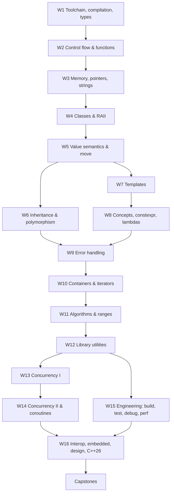

# C++ from Zero to Advanced

**A friendly, intuition-first C++ course** — from your first `main()` to lock-free queues, coroutines,
and embedded-style containers. 16 weeks, short video-sized lessons, quizzes, labs, and programming
assignments. Every code example on this site is a real file that is compiled and run automatically.

!!! quote "The idea behind this course"
    You don't need to memorize the standard. You need good *intuition* for what the machine is doing,
    a handful of reliable habits, and lots of small, successful steps. We'll build all three — one idea at a time.

## Who this is for

- You've programmed before (any language) and want to learn C++ properly.
- You already write *some* C++ (maybe through Android NDK, game engines, or embedded work) and want real depth:
  value categories, move semantics, the memory model, templates and concepts, and how professionals build,
  test, and profile C++.

## The learning roadmap

## Course structure

Each **week** has 5–7 lessons. Each **lesson** is sized like a 6–12 minute video and follows the same rhythm:

1. **Why this matters** — a concrete problem that motivates the idea.
2. **The idea**, built up from a tiny example, often showing *the wrong way first*, then the fix.
3. **Key takeaways** — a short recap.
4. **Quiz** — 3–5 questions with hidden answers.
5. **Practice lab** (optional) — starter code and a full solution.

Each week ends with a **week quiz** and a **programming assignment**. The course ends with two
[capstone projects](capstone/index.md).

Start with [How to take this course](how-to-take.md), then [Setup](setup.md), then
[Week 1](week01/index.md). And keep the [Feature checklist](curriculum/feature-checklist.md) handy.
