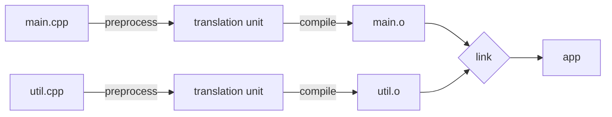

# Lesson 1.2: The compilation model: preprocessor, translation units, linking, ODR

<span class="stdtag">C++20</span> · about 12 minutes

## Why this matters

Here's a problem you've probably hit: your code compiles, but then the build fails with
`undefined reference to 'foo()'`. Or the opposite: `multiple definition of 'foo'`. These errors aren't
from the compiler at all — they're from the *linker*. Understanding the three stages of a build makes these
errors go from mysterious to obvious. Let's see how this works.

## Three stages

When you run `g++ main.cpp util.cpp -o app`, three things happen:



1. **Preprocessing.** Text substitution. `#include "util.h"` literally pastes the contents of `util.h`
   in place. `#define` and `#if` are also handled here. The result is a **translation unit** (TU).
2. **Compilation.** Each TU is compiled *independently* into an object file (`.o`). The compiler
   only knows what it can see in that one TU.
3. **Linking.** The linker stitches object files and libraries together, matching each *use* of a
   function with its single *definition*.

That word "independently" is the key to everything. When compiling `main.cpp`, the compiler has never
seen `util.cpp`. So how can `main` call a function defined there? Through a **declaration**.

## Declarations vs definitions

- A *declaration* says "this thing exists, and here is its type": `int add(int, int);`
- A *definition* provides the thing itself: `int add(int a, int b) { return a + b; }`

You can declare something many times, but (for most things) define it exactly once in the whole program.
That's the **One Definition Rule (ODR)**.

So the classic layout is: declarations in a header (`util.h`), definitions in a source file (`util.cpp`),
and every file that needs them includes the header.

```cpp
// util.h
#pragma once            // include guard: paste this file at most once per TU
int add(int a, int b);  // declaration only

// util.cpp
#include "util.h"
int add(int a, int b) { return a + b; }  // the one definition

// main.cpp
#include "util.h"
int main() { return add(2, 3); }
```

Now the two classic errors become easy to explain:

- **`undefined reference to add(int, int)`**: you declared it, used it, but the linker never got an
  object file containing the definition. (Forgot to compile/link `util.cpp`, or the signatures differ.)
- **`multiple definition of add`**: you put the *definition* in the header, and two `.cpp` files included
  it. Now two object files both define `add`.

## The wrong way, then the fix

Putting a definition in a header is the most common mistake:

```cpp
// config.h  -- WRONG if included from two .cpp files
int max_users = 100;          // a definition! each TU gets its own -> link error
```

There are two good fixes. The C++17 way is an **inline variable**: `inline` tells the linker "there may be
identical copies in many TUs; keep one".

```cpp
// config.h  -- OK
inline int max_users = 100;          // C++17 inline variable
constexpr int max_sessions = 8;      // constexpr at namespace scope: internal linkage, also fine
```

Functions defined in headers need `inline` for the same reason (member functions defined inside a class
body and templates are implicitly OK).

## Internal linkage: keeping helpers private

Sometimes a helper should be visible only inside one `.cpp` file. Put it in an **anonymous namespace**
(or mark it `static`). It then has *internal linkage*: two files can each have their own `helper()` with
no conflict.

Here's a single-file program that demonstrates these ideas — we can't show multiple files in one
example, but we can show the declaration/definition split and internal linkage:

```cpp title="examples/week01/lesson02.cpp"
--8<-- "examples/week01/lesson02.cpp"
```

**Output**:

```text
--8<-- "examples/week01/lesson02.out"
```

## The preprocessor: useful, but keep it small

The preprocessor knows nothing about C++ — it's text substitution. That's exactly why macros are
risky. The classic bug:

```cpp
#define SQUARE(x) x * x
int y = SQUARE(1 + 2);   // expands to 1 + 2 * 1 + 2 == 5, not 9!
```

In modern C++, use `constexpr` functions instead of function-like macros. Keep the preprocessor for
`#include`, include guards, and conditional compilation (`#if defined(__ANDROID__)`), which is still
genuinely useful.

!!! warning "Common pitfall: ODR violations that *don't* error"
    If two TUs define the *same inline function or class* differently (say, different `#define`s
    changed a struct's layout), the linker usually picks one silently. That's undefined behaviour and
    a nightmare to debug. Keep headers self-contained and avoid configuration macros that change
    layouts. In C++20, **modules** (Week 15) fix much of this.

## Key takeaways

!!! success "Key takeaways"
    - Build = preprocess → compile each translation unit independently → link.
    - Headers hold declarations; one `.cpp` holds each definition (the ODR).
    - `undefined reference` = missing definition at link time; `multiple definition` = defined in a header without `inline`.
    - Use `inline` (C++17) variables / functions or `constexpr` for things defined in headers.
    - Prefer `constexpr` functions over function-like macros.

## Quiz

**Q1.** You get `undefined reference to 'foo()'`. Is this a compiler or linker error, and what are two likely causes?

??? question "Show answer"
    A linker error. Either the `.cpp` defining `foo` wasn't compiled/linked into the program, or the declaration and definition don't match (different parameter types, namespace, or `extern "C"` mismatch).

**Q2.** Why does `int x = 5;` in a header cause trouble, but `inline int x = 5;` doesn't?

??? question "Show answer"
    Each TU that includes the header gets its own definition of `x`, violating the ODR (multiple definitions at link time). `inline` allows identical definitions in multiple TUs; the linker merges them.

**Q3.** What does `SQUARE(1+2)` evaluate to with `#define SQUARE(x) x * x`?

??? question "Show answer"
    5, because it expands textually to `1 + 2 * 1 + 2`. Use a `constexpr` function instead.

**Q4.** What does an anonymous namespace do?

??? question "Show answer"
    Gives everything inside it internal linkage, so it is private to that translation unit and can't clash with names in other files.

