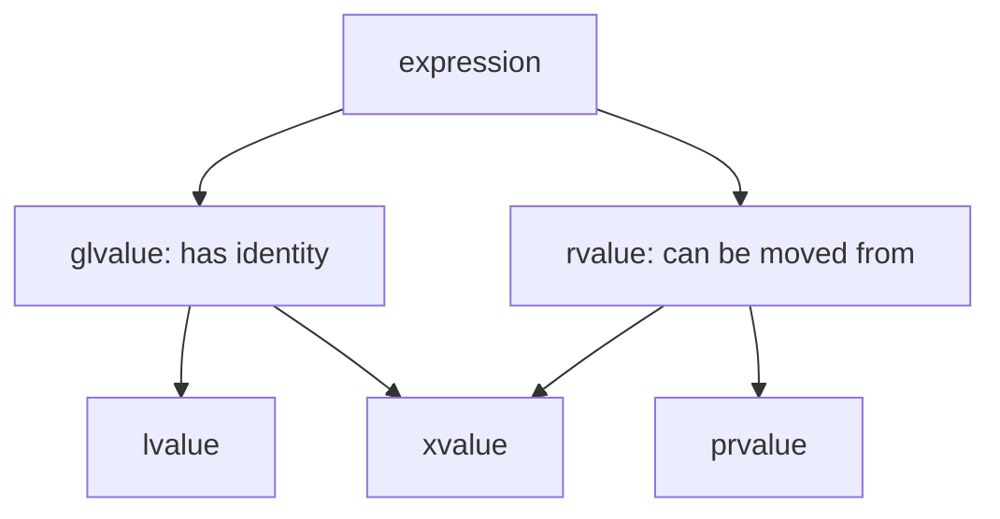

# Lesson 5.2: Value categories: lvalues, prvalues, xvalues

<span class="stdtag">C++20</span> · about 12 minutes

## Why this matters

To make moves work, the compiler needs to know one thing about every expression: *is this an object that
someone still cares about, or one that's about to disappear?* If it's about to disappear, it's safe to steal
its insides. That's what value categories are — and despite the scary names, the intuition is simple.

## The intuition: "has a name / identity" vs "about to die"

- An **lvalue** is an expression that refers to an object with identity that will still exist after the
  expression: a named variable `x`, `*p`, `v[0]`, a function returning `T&`. You can take its address.
- A **prvalue** ("pure rvalue") is a value with no identity yet: `42`, `a + b`, `std::string{"hi"}`,
  a function returning `T` by value. It's a recipe for creating an object.
- An **xvalue** ("expiring value") is an object that *has* identity but which we've declared we're done
  with: `std::move(x)`, or a function returning `T&&`.

Grouping them: **rvalues** = prvalues + xvalues ("can be moved from"); **glvalues** = lvalues + xvalues
("has identity").



## Rvalue references: `T&&`

A `T&&` parameter binds **only to rvalues**. So you can overload a function: one version for lvalues
(`const T&`: "I'll copy if needed") and one for rvalues (`T&&`: "you can steal from this").

```cpp title="examples/week05/lesson02.cpp"
--8<-- "examples/week05/lesson02.cpp"
```

**Output**:

```text
--8<-- "examples/week05/lesson02.out"
```

Read that output carefully, especially the last line. Inside `take(std::string&& s)`, the parameter
`s` **is an lvalue**! It has a name, so it's not about to disappear inside the function. That's why,
to pass it on as an rvalue, you'd have to say `std::move(s)` again. This is the #1 confusion about
rvalue references: *the type is "rvalue reference", the expression `s` is an lvalue.*

## Seeing categories with `decltype`

`decltype((expr))` (double parentheses!) gives `T&` for lvalues, `T&&` for xvalues and `T` for prvalues.
The example uses this to print categories — a nice trick for experiments in Compiler Explorer.

## C++17: guaranteed copy elision and temporary materialization

Since C++17 a prvalue isn't an object until it needs to be: `T x = T{};` constructs *directly* into `x` —
no temporary, no move. The prvalue is only "materialized" into a temporary (becoming an xvalue) when it
must be, e.g. when binding to a reference. We'll use this in Lesson 5.4.

!!! note "Don't memorize the taxonomy"
    You need two working rules: (1) a named thing is an lvalue, even if its type is `T&&`; (2)
    `std::move(x)` turns `x` into an rvalue so a move can happen.

## Key takeaways

!!! success "Key takeaways"
    - lvalue: has identity and persists; prvalue: a value with no identity yet; xvalue: an object we've marked as expiring.
    - `T&&` parameters bind only to rvalues; overload on `const T&` / `T&&` to copy or steal.
    - A named rvalue reference is an lvalue expression — use `std::move` again to pass it on.
    - `decltype((e))` reveals the value category; C++17 prvalues materialize only when needed.

## Quiz

**Q1.** Classify: `v[0]` (vector<int> v), `v.size()`, `std::move(v)`, `"hello"`.

??? question "Show answer"
    `v[0]` lvalue (returns `int&`); `v.size()` prvalue; `std::move(v)` xvalue; a string literal is an lvalue (an array object with static storage).

**Q2.** Inside `void f(Widget&& w)`, which overload does `g(w)` call: `g(const Widget&)` or `g(Widget&&)`?

??? question "Show answer"
    `g(const Widget&)`. `w` is a named variable, hence an lvalue. To call the `&&` overload write `g(std::move(w))`.

**Q3.** What's the difference between `decltype(x)` and `decltype((x))` for `int x`?

??? question "Show answer"
    `decltype(x)` is the declared type `int`; `decltype((x))` treats `(x)` as an lvalue expression and gives `int&`.

