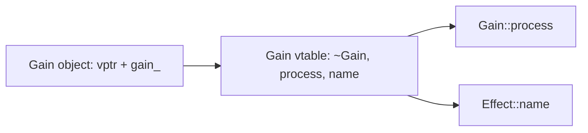

# Lesson 6.2: Virtual functions, override, final, and how vtables work

<span class="stdtag">C++20</span> · about 12 minutes

## Why this matters

Now the payoff. You have a `std::vector<Effect*>` holding a gain, an echo and a filter, and you want
`for (auto* e : chain) e->process(buffer);` to call *the right* `process` for each one. That's
**dynamic dispatch**, and it's what `virtual` gives you. Let's also peek under the hood, because knowing
how it works tells you exactly what it costs.

## `virtual` and `override`

```cpp
struct Effect {
    virtual ~Effect() = default;
    virtual void process(std::span<float> buf) = 0;   // (= 0: pure virtual; next lesson)
};
struct Gain : Effect {
    void process(std::span<float> buf) override { ... }
};
```

When a function is `virtual`, a call through a base reference or pointer runs the *most-derived override*
at run time. Always write `override` on overrides: if the signature doesn't actually match (a missing
`const`, a different parameter type), the compiler errors instead of silently creating a new, unrelated
function.

```cpp
struct Base { virtual void draw() const; };
struct Oops : Base { void draw(); };            // WRONG: no const -> a new function, not an override
struct Good : Base { void draw() const override; };
```

`final` on a function stops further overriding; on a class, stops inheritance. It also helps the
optimizer *devirtualize* calls.

```cpp title="examples/week06/lesson02.cpp"
--8<-- "examples/week06/lesson02.cpp"
```

**Output**:

```text
--8<-- "examples/week06/lesson02.out"
```

## How it works: vtables

The standard doesn't say, but every mainstream compiler does the same thing:

- Each class with virtual functions has a static table, the **vtable**, holding pointers to its versions of
  each virtual function.
- Each object of such a class holds a hidden pointer, the **vptr**, to its class's vtable (that's why
  `sizeof` grew by 8 in the output).
- A virtual call is: load the vptr, load the function pointer from a fixed slot, call it.



So the cost is one or two extra loads and an indirect call, plus — more importantly — the call usually
**can't be inlined**. In a per-sample inner loop that matters; per buffer, it's noise. Design accordingly:
make virtual calls coarse-grained (process a whole buffer, not one sample).

## Virtual calls in constructors and destructors

During `Effect`'s constructor, the object is *only* an `Effect` yet — the derived part doesn't exist. A
virtual call there calls `Effect`'s version, not the derived one. The example shows this.

## Key takeaways

!!! success "Key takeaways"
    - `virtual` + a base pointer/reference = the most-derived override runs at run time.
    - Always mark overrides `override`; use `final` to forbid further overriding.
    - Vtable model: one table per class, one hidden vptr per object; virtual calls block inlining.
    - In constructors and destructors, virtual calls resolve to the current class, not the derived one.

## Quiz

**Q1.** What does `override` buy you?

??? question "Show answer"
    A compile error if the function doesn't actually override a base virtual function (e.g. signature mismatch), instead of a silent new function.

**Q2.** Why did `sizeof(WithVirtual)` grow?

??? question "Show answer"
    Objects of a polymorphic class carry a hidden vptr (8 bytes on 64-bit), plus padding for alignment.

**Q3.** What's the main performance cost of a virtual call?

??? question "Show answer"
    Usually not the indirect call itself but the lost inlining and optimization across the call; also possible branch mispredictions. Keep virtual calls coarse-grained.

