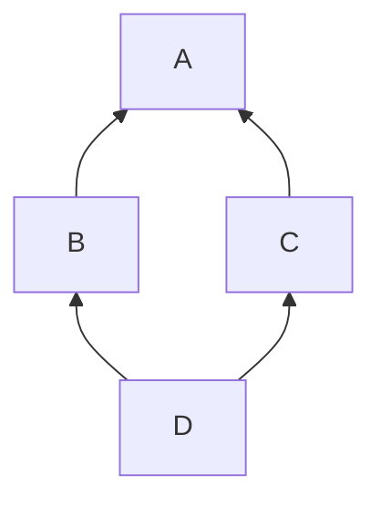

# Lesson 6.4: Multiple and virtual inheritance (optional)

<span class="stdtag">C++20</span> · about 9 minutes

## Why this matters

Can a class inherit from two base classes? In C++, yes. It's mostly useful for implementing several
*interfaces* at once — a `MediaPlayer` that is both an `AudioSink` and a `Controllable`, say. This lesson
is marked optional: you'll rarely write complex multiple inheritance, but you'll meet it in frameworks
and you should understand the diamond problem when you see it.

## Implementing several interfaces

This is the safe, common use: each base is an interface (no data), and the class implements all of them.

## The diamond

If `B` and `C` both inherit from `A`, and `D` inherits from both `B` and `C`, then by default `D` contains
**two** `A` subobjects. `d.a_member` is ambiguous, and converting `D*` to `A*` is ambiguous.



**Virtual inheritance** (`class B : public virtual A`) makes `B` and `C` share a single `A` subobject. The
price: the most-derived class must construct the virtual base directly, layout is more complex, and access
to the virtual base goes through an extra indirection.

```cpp title="examples/week06/lesson04.cpp"
--8<-- "examples/week06/lesson04.cpp"
```

**Output**:

```text
--8<-- "examples/week06/lesson04.out"
```

## Pointer adjustment

With multiple bases, converting `Player*` to `Controllable*` may *change the pointer value*: the
`Controllable` subobject lives at an offset inside the `Player`. That's normal and handled by the compiler
— but it's why you must never cast between such pointers with `reinterpret_cast` or through `void*`
without going back to the exact original type.

!!! tip "Practical advice"
    Multiple inheritance of interfaces: fine. Multiple inheritance of classes with state: think twice.
    Virtual inheritance: only when you truly need the shared-base semantics (e.g. `std::iostream`
    inherits virtually from `std::ios_base` via `basic_ios`).

## Key takeaways

!!! success "Key takeaways"
    - Multiple inheritance of interfaces is common and safe.
    - A diamond without virtual inheritance duplicates the shared base; `virtual` inheritance shares it.
    - The most-derived class initializes virtual bases.
    - Converting between base pointers may adjust the address — use `static_cast`/`dynamic_cast`, never `reinterpret_cast`.

## Quiz

**Q1.** In a non-virtual diamond, how many `A` subobjects does `D` have?

??? question "Show answer"
    Two — one via `B` and one via `C`.

**Q2.** With virtual inheritance, who calls the virtual base's constructor?

??? question "Show answer"
    The most-derived class. Initializers for the virtual base in intermediate classes are ignored when they aren't the most-derived.

**Q3.** Why can `static_cast<void*>(s) != static_cast<void*>(c)` be true for the same object?

??? question "Show answer"
    The two base subobjects live at different offsets within the derived object.

