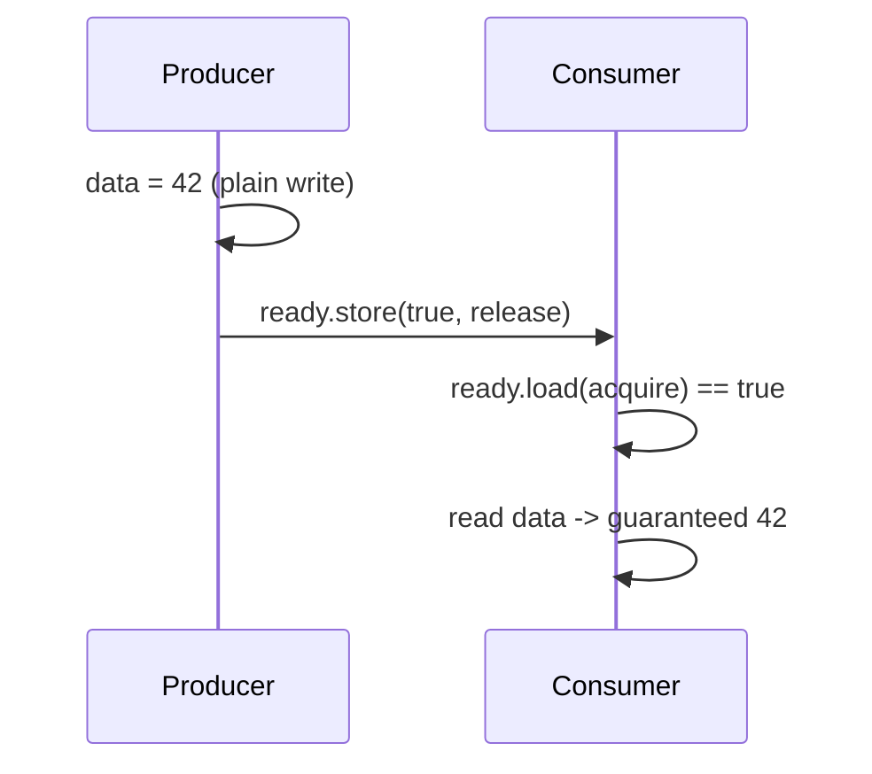

# Lesson 14.1: Atomics and the memory model

<span class="stdtag">C++20</span> · about 15 minutes

## Why this matters

Modern CPUs and compilers reorder memory operations aggressively for speed. On one thread you never notice.
Across threads, it means writing `data = 42; ready = true;` doesn't guarantee another thread that sees
`ready == true` also sees `data == 42`. The memory model tells you exactly what's guaranteed — and atomics
with the right memory order give you those guarantees without a mutex.

## Atomics: indivisible operations

`std::atomic<int> n; ++n;` is a single indivisible read-modify-write — no lost updates, no data race.
`compare_exchange_weak(expected, desired)` is the building block of lock-free algorithms: "if the value is
still `expected`, set it to `desired`; otherwise tell me the current value".

## Memory order, intuitively

- **`seq_cst`** (default): all threads agree on one global order of all seq_cst operations. Easiest to
  reason about. Use it unless you've measured a need.
- **`release` store + `acquire` load**: the publishing pattern. Everything written before the release
  store is visible to a thread whose acquire load reads that store. This is "message passing".
- **`relaxed`**: atomic, but no ordering of *other* memory. Fine for counters and statistics.



```cpp title="examples/week14/lesson01.cpp"
--8<-- "examples/week14/lesson01.cpp"
```

**Output**:

```text
--8<-- "examples/week14/lesson01.out"
```

## `volatile` is not a synchronization tool

`volatile` stops the compiler from optimizing away accesses (for memory-mapped hardware registers — Week 16)
but provides no atomicity and no inter-thread ordering. Using it for flags between threads is a data race.

## C++20 additions

`atomic::wait(old)` blocks until the value changes (efficient, futex-based), `notify_one/all` wakes waiters.
`std::atomic_ref` performs atomic operations on a plain object you don't own (e.g. inside an array).

!!! warning "Honest advice"
    Weaker orders than `seq_cst` are an expert tool. A wrong `relaxed` can pass all tests on x86 (strongly
    ordered hardware) and fail on ARM. If you use them, document *why* each one is correct.

## Key takeaways

!!! success "Key takeaways"
    - Atomics make single operations indivisible; `compare_exchange` is the lock-free building block.
    - Release/acquire pairs publish data from one thread to another.
    - `relaxed` is fine for independent counters; default to `seq_cst` otherwise.
    - `volatile` is not for threading; C++20 adds `wait`/`notify` and `atomic_ref`.

## Quiz

**Q1.** Why might `ready.store(true, relaxed)` be insufficient for publishing `data`?

??? question "Show answer"
    Relaxed provides no ordering of other memory, so the consumer may see `ready == true` but a stale `data`.

**Q2.** Why does `compare_exchange_weak` sit in a loop?

??? question "Show answer"
    It can fail spuriously and fails when another thread changed the value; on failure it updates `expected`, so you retry.

**Q3.** Is `volatile bool flag` a correct way to signal between threads?

??? question "Show answer"
    No — it's still a data race (UB) with no ordering guarantees; use `std::atomic<bool>`.

