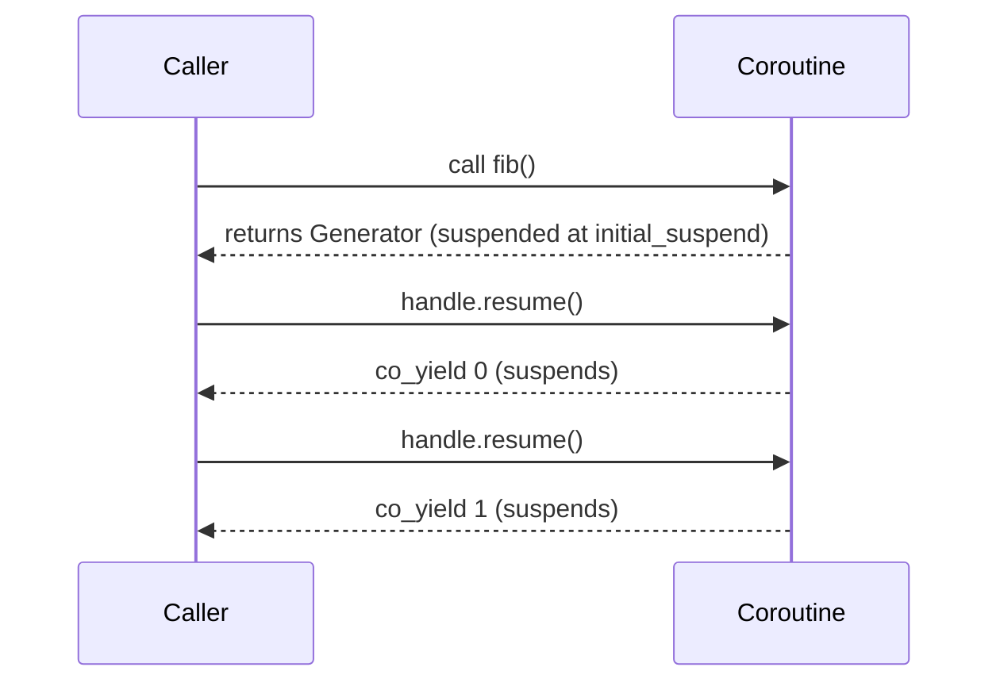

# Lesson 14.5: Coroutines I: the machinery, and writing a generator

<span class="stdtag">C++20</span> · about 15 minutes

## Why this matters

A coroutine is a function that can **pause** in the middle and **resume** later, keeping its local variables.
That lets you write a lazy sequence ("yield the next sample") or an async operation ("wait for the network,
then continue") as straight-line code instead of callbacks and state machines. C++20 gives you the raw
machinery; libraries (and C++23's `std::generator`) give you friendly types. Let's see the machinery once.

## What makes a function a coroutine

Any function whose body uses `co_yield`, `co_await` or `co_return`. The compiler then:

1. allocates a **coroutine frame** (locals + state), usually on the heap;
2. creates a **promise object** of type `ReturnType::promise_type`;
3. calls `promise.get_return_object()` to make the value returned to the caller;
4. inserts suspension points at `initial_suspend`, each `co_yield`/`co_await`, and `final_suspend`.



## A minimal generator

```cpp title="examples/week14/lesson05.cpp"
--8<-- "examples/week14/lesson05.cpp"
```

**Output**:

```text
--8<-- "examples/week14/lesson05.out"
```

The caller owns the `coroutine_handle` and must `destroy()` it — our `Generator` does that in its
destructor (RAII again). Lifetime is the main trap: a coroutine that takes a reference parameter and
outlives the referent dangles. Prefer taking parameters **by value** in coroutines.

## In practice

Use `std::generator` (C++23, Week 11) when available; write your own types only when you need special
behaviour. The point of this lesson is that you can now *read* coroutine library code.

## Key takeaways

!!! success "Key takeaways"
    - A coroutine is a function that can suspend and resume, keeping its state in a coroutine frame.
    - The return type's `promise_type` controls behaviour; `coroutine_handle` resumes and destroys it.
    - Wrap the handle in an RAII type that calls `destroy()`.
    - Take coroutine parameters by value to avoid dangling references.

## Quiz

**Q1.** What makes a function a coroutine?

??? question "Show answer"
    Using `co_await`, `co_yield` or `co_return` in its body.

**Q2.** Why does our generator use `suspend_always` for `initial_suspend`?

??? question "Show answer"
    So the body doesn't run until the caller asks for the first value (lazy).

**Q3.** Why is `Generator<std::string> tokens(const std::string& s)` risky?

??? question "Show answer"
    The coroutine may run after the caller's argument (e.g. a temporary) is destroyed, leaving a dangling reference.

